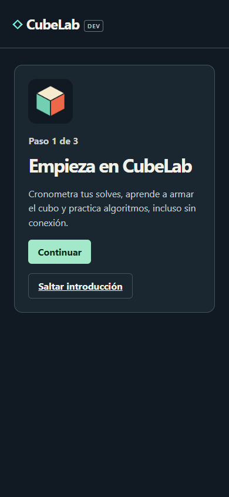
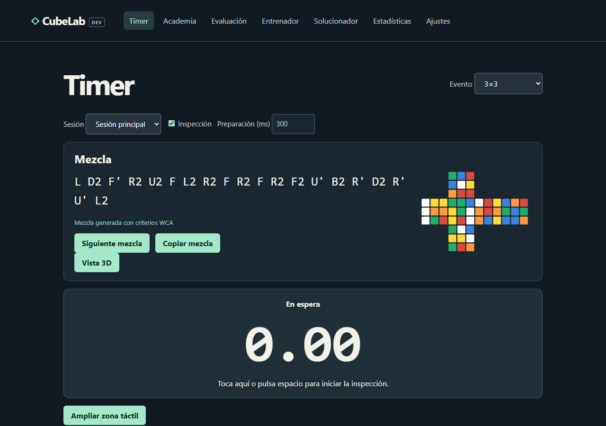

# CubeLab

PWA bilingüe de speedcubing para 2×2, 3×3, 3×3 a ciegas, Pyraminx, Pyraminx Duo y Skewb. Incluye Timer, sesiones y estadísticas, una Academia con catálogos verificados, un Solucionador por etapas y un Entrenador con repetición espaciada. Las funciones principales quedan disponibles sin conexión después de preparar la instalación.

[Changelog 1.0.0](CHANGELOG.md) · [Arquitectura](docs/ARQUITECTURA.md) · [Decisiones](docs/DECISIONES.md) · [Fuentes](docs/FUENTES.md)

## Capturas





## Arranque y diagnóstico

Requiere Node 22.16 o superior y npm.

```powershell
npm.cmd ci
npm.cmd run dev
```

En Windows, ejecuta el diagnóstico de aceptación con Microsoft Edge:

```powershell
powershell.exe -NoProfile -ExecutionPolicy Bypass -File .\tools\diagnostico.ps1 -ConE2E
```

El diagnóstico incluye tipos, lint, filtros de mezclas, Vitest, build, manifiesto, precache y Playwright. Guarda el detalle en `diagnostico-*.log`. La variante `-Rapido` omite comprobaciones largas. En Linux, CI usa Chromium de Playwright 1.65.1 en `ubuntu-latest`, compatible con Ubuntu 26.04. Para probar en otro Chromium ya instalado, establece `CUBELAB_E2E_BROWSER=chromium` y apunta `CUBELAB_E2E_EXECUTABLE` al ejecutable.

## Videos recomendados

Las lecciones con recursos asociados muestran enlaces externos a YouTube y una búsqueda en el idioma de la app. Cuando el navegador está sin conexión, la sección conserva los títulos y muestra «Requiere internet».

## Pyraminx y Pyraminx Duo

- **Pyraminx** usa el evento WCA con inspección de 15 s y Ao5. En Timer puedes alternar la vista plana y 3D. El Solucionador muestra la secuencia óptima en dos etapas, capas y puntas.
- **Pyraminx Duo** es un evento de práctica. La academia, el entrenador y el solucionador muestran un desplegado en 2D. Elige la solución óptima o el método de dos pasos.
- Para integrar el contenido de Pyraminx, copia `algsets.json` y `lessons.json` v1 en `content-drop/pyram/`, junto con su informe `VERIFICACION.md`, y vuelve a compilar. Los tests verifican el drop activo y muestran el set, caso y variante cuando falla un algoritmo. Si no hay ningún JSON, se usa el fixture. Si solo hay uno, la importación falla. [Contrato y criterios](docs/ARQUITECTURA.md#puzzles-tetraédricos)

## Skewb

En Timer, elige **Skewb** para usar el evento WCA con Ao5, inspección de 15 s y vista 2D o 3D. En Solucionador puedes elegir la ruta óptima o resolver en tres etapas, primera capa, esquinas de arriba y centros. Las mezclas escritas admiten `R U L B` con prima. Los algoritmos del drop también admiten `x y z`, con prima o con `2`.

El contenido de Academia y Entrenador se incorpora al compilar desde `content-drop/skewb/algsets.json` y `content-drop/skewb/lessons.json`. El contrato es v1. Los IDs de sets empiezan con `skewb-` y la fuente puede ser una URL HTTP(S) o texto `generated:`. Si faltan ambos JSON se usa un fixture técnico. Si falta solo uno o una variante falla la verificación, Academia y Entrenador muestran el error.

## Publicación

El workflow publica un preview con etiqueta DEV a partir de `main`. El release se construye desde un tag y solo se publica tras pasar `release:check` y las pruebas. Queda desactivado mientras `CUBELAB_RELEASE_REF` esté sin definir. [Pasos exactos para crear el repositorio, hacer push y conectar GitHub Pages](docs/PUBLICACION.md)

El preview se publica en `https://TU_USUARIO.github.io/cubelab/preview/`. Preview y release guardan los datos por separado. **Ajustes → Datos locales** permite exportar un respaldo JSON y borrar los datos de la instalación actual. En Estadísticas puedes importar el respaldo. Se admiten respaldos v1, v2 y v3.

## Rendimiento móvil

Lighthouse 13.6.0, perfil móvil, Chrome 157, perfil nuevo y build de producción.

| Medición | Antes, entrada a Timer | Después, primera apertura |
| --- | ---: | ---: |
| Performance | 99 | 99 |
| Accessibility | 100 | 100 |
| LCP | 2,0 s | 2,0 s |

El visor 3D se ejecuta bajo demanda. Una prueba con el service worker bloqueado verifica que Timer en 2D no solicita el motor de 511 kB hasta habilitar la vista 3D. El service worker descarga una copia para uso sin conexión después de la carga inicial. El precache de la fase 7 ocupa alrededor de 3,17 MiB sin compresión. Incluye las lecciones, los catálogos y los módulos que usan sus workers para que sea posible abrirlos por primera vez en modo avión.

Lighthouse retiró la categoría PWA. La instalación se verifica mediante el manifiesto, el service worker, las pruebas offline y la instalación real en Android. [Criterio de Chrome](https://developer.chrome.com/blog/update-install-criteria)

Para repetir la medición, sirve el build con `npm.cmd run preview`. En Edge o Chrome, abre DevTools → **Lighthouse**, elige móvil y las categorías Performance y Accessibility. Usa un perfil nuevo para medir la primera apertura. Para guardar un informe JSON, con Node 22.19 o superior:

```powershell
npx.cmd --yes --package=lighthouse@13.6.0 lighthouse http://localhost:4173/ --form-factor=mobile --only-categories=performance,accessibility --output=json --output-path=lighthouse.json
```

## Prueba manual del MVP

**PC en Edge**

1. Abre el preview en una ventana InPrivate para ver la primera apertura. Prueba la elección de puzzle y la ruta de principiante. En una instalación ya inicializada, Ajustes permite restablecer el flujo tras exportar los datos.
2. En Timer guarda un solve. Luego abre el intento en Estadísticas y usa **Ver en el solucionador**. Resuelve y revisa al menos una etapa.
3. Completa Notación en Academia, prepara un caso en Entrenador y responde una Evaluación. Cambia tema, tamaño del timer y vista previa en Ajustes, y confirma que se mantienen tras recargar.

**Android desde el preview**

1. Abre la URL HTTPS en Chrome. Comprueba la etiqueta DEV y elige **Instalar app** en el menú del navegador. Abre CubeLab desde el icono.
2. En **Ajustes → Datos locales**, espera **Listo para usar sin conexión**. Cierra la app.
3. Activa modo avión con Wi-Fi apagado y reabre desde el icono. Genera una mezcla, registra un solve y revisa que persista al volver a abrir.
4. En modo avión, reproduce una lección 3D, solicita una solución y pide un caso nuevo en Entrenador. Entra a Evaluación y verifica que carga el cuestionario.

## Antes del lanzamiento

- [ ] Apaga los `DEV-FLAG` en la referencia de release y ejecuta `npm.cmd run release:check`.
- [ ] Ejecuta el diagnóstico completo con Edge y comprueba **FALLAS: 0**.
- [ ] Activa el release de acuerdo con la guía de publicación y comprueba su URL.
- [ ] Instala desde la URL de release en Android y comprueba su reapertura y funciones en modo avión.
